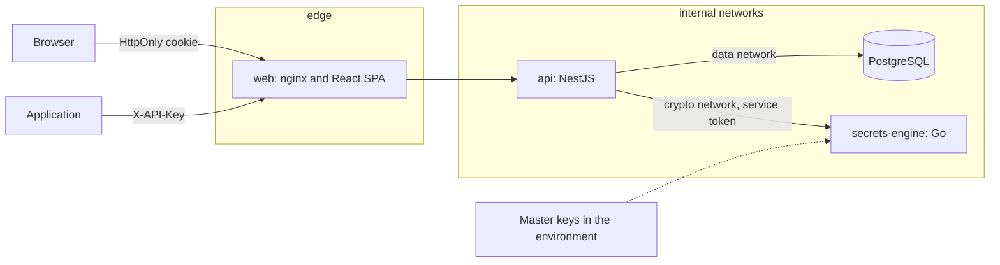
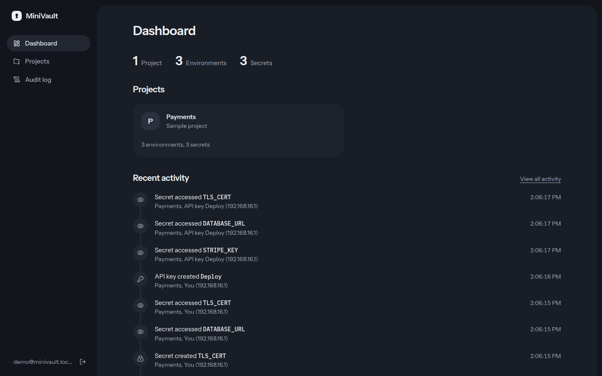
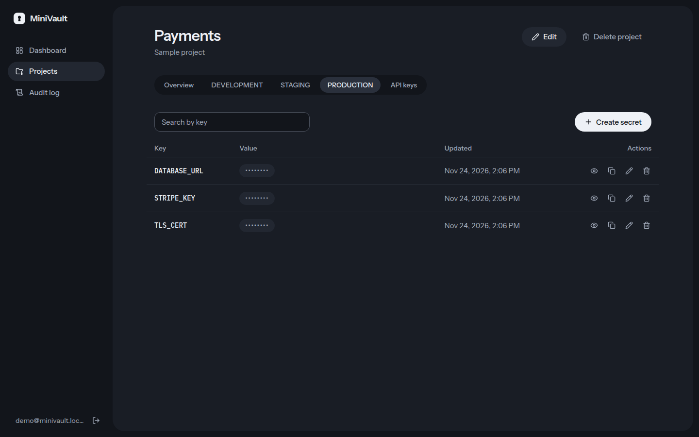
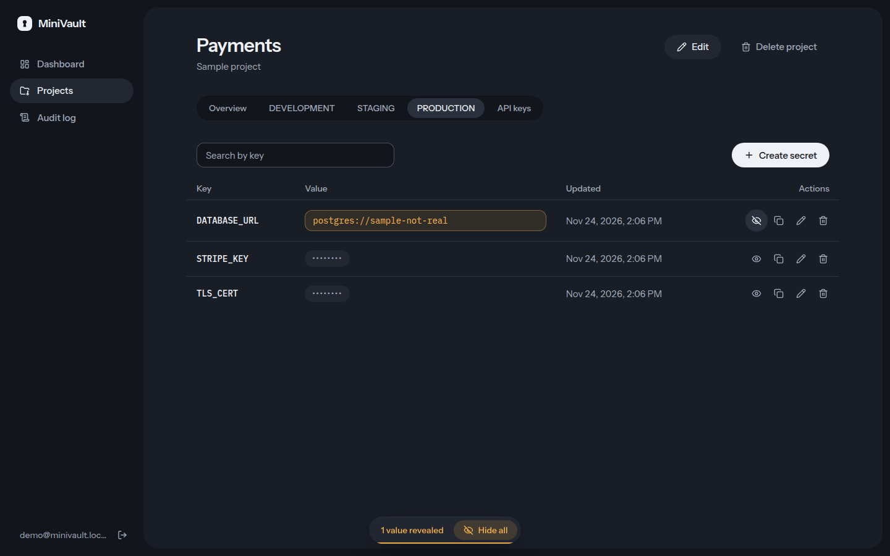
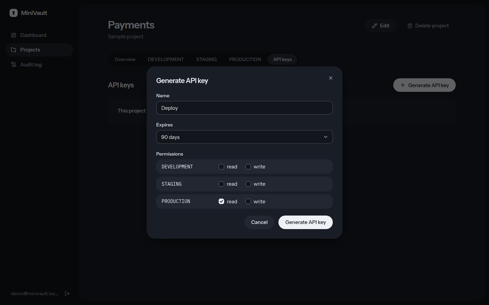
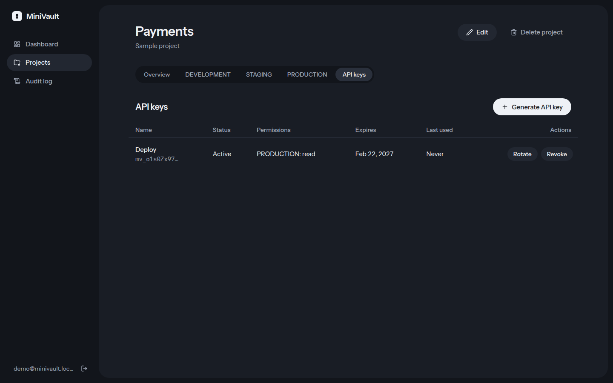
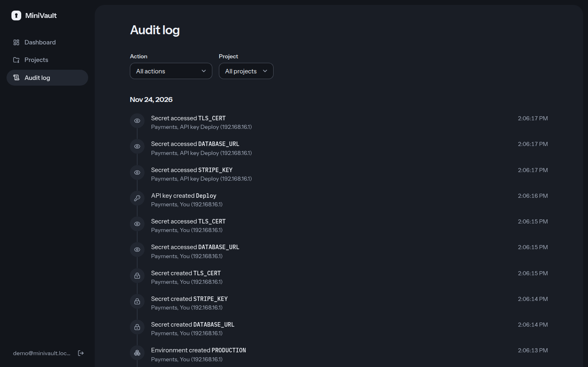

# MiniVault

A lightweight secrets management platform: projects, environments, encrypted secrets, API keys and an audit log, behind a REST API and a dashboard.

> **Experimental.** MiniVault is an educational and portfolio project. It has had no independent security review and is not suitable for production secrets. See [Known limitations](#known-limitations).

## Features

- Projects with isolated DEVELOPMENT, STAGING and PRODUCTION environments.
- Secrets encrypted with AES-256-GCM by a separate Go service; the database holds ciphertext only.
- Each ciphertext is bound to its project, environment and secret, so it cannot be moved.
- API keys scoped per environment (read, write), with expiry, rotation and revocation. Shown once, stored as hashes.
- Append-only audit log, written in the same transaction as the operation. An access that cannot be audited returns nothing.
- Dashboard that masks values, reveals them only on request, and hides them again by itself.

## Architecture



Only `web` publishes a port. Both backends follow DDD and Hexagonal Architecture, and their dependency rules are checked by the test suite. Details: [docs/ARCHITECTURE.md](docs/ARCHITECTURE.md).

## Technology stack

| Part | Stack |
|---|---|
| Frontend | React 19, TypeScript, Vite, Tailwind CSS 4, shadcn/ui conventions on Radix, React Router, TanStack Query, React Hook Form, Zod |
| API | Node.js 24, NestJS 12, Prisma 7, PostgreSQL 18, Argon2id, JWT, OpenAPI, Jest, Supertest |
| Secrets engine | Go 1.27, Gin, AES-256-GCM, slog |
| Infrastructure | Docker Compose, multi-stage non-root images, Testcontainers |

## Screenshots

| | |
|---|---|
|  |  |
|  |  |
|  |  |

The interface is neutral. Amber appears only while plaintext is on screen.

## Prerequisites

Docker with Compose v2, and `openssl`. For development also Node.js 24. Go is not needed: its toolchain runs in a container.

## Installation

```sh
sh scripts/init-env.sh        # once: writes .env with random credentials
docker compose up --build     # http://localhost:8080
```

**Back up `.env`.** Without `MASTER_KEYS`, stored secrets cannot be decrypted.

Optional demonstration data:

```sh
docker compose --profile demo run --rm seed
```

It creates `demo@minivault.local`, with the password in `DEMO_USER_PASSWORD` in `.env`.

## Environment variables

| Variable | Used by | Meaning |
|---|---|---|
| `WEB_PORT` | compose | Published port, default 8080 |
| `WEB_ORIGIN` | api | Browser origin; must match the port |
| `COOKIE_SECURE` | api | `true` when served over HTTPS |
| `POSTGRES_PASSWORD` | postgres, api | Database password |
| `JWT_SECRET` | api | At least 32 characters |
| `ENGINE_AUTH_TOKEN` | api, engine | Service token, at least 32 characters |
| `MASTER_KEYS` | engine | `<version>:<base64 of 32 bytes>`, comma separated |
| `ACTIVE_KEY_VERSION` | engine | Version used for new encryptions |
| `DEMO_USER_PASSWORD` | seed | Password of the demo user |

API tuning, with defaults: `JWT_TTL_SECONDS=1800`, `ENGINE_TIMEOUT_MS=3000`, `THROTTLE_LIMIT=100`, `AUTH_THROTTLE_LIMIT=5` (requests per minute, per address and route).

## Running locally

See [docs/DEVELOPMENT.md](docs/DEVELOPMENT.md).

## Running tests

```sh
npm ci
npm test              # unit, architecture and web tests
npm run test:e2e      # API integration tests against real PostgreSQL and the real engine
npm run engine:test   # Go tests with the race detector
sh scripts/verify.sh  # everything, plus a throwaway stack
```

## API documentation

Swagger UI at `http://localhost:8080/api/docs`; overview in [docs/API.md](docs/API.md). An application reads its secrets with one request:

```sh
curl -H "X-API-Key: $MINIVAULT_KEY" "http://localhost:8080/api/v1/machine/secrets?environment=PRODUCTION"
```

## Security considerations

Threat model, encryption, key management and access control: [docs/SECURITY.md](docs/SECURITY.md).

## Known limitations

- Master keys come from environment variables. There is no KMS or HSM and no automatic re-encryption.
- The Compose setup serves plain HTTP. Put a TLS proxy in front and set `COOKIE_SECURE=true`.
- Rate limits are kept in memory, so they assume one API instance.
- A project has one owner. There are no teams or roles.
- Secrets have no version history, and their keys cannot be renamed.
- There is no password reset, email verification or second factor. Signing out clears the cookie, but a copied token stays valid until it expires (30 minutes).
- Behind Docker's port mapping the audited address can be the Docker gateway's.
