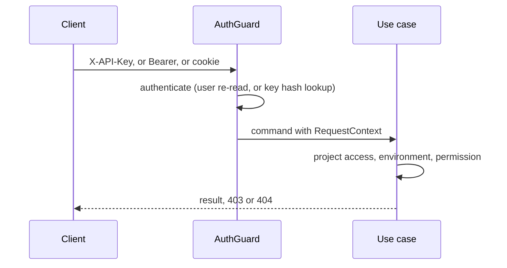
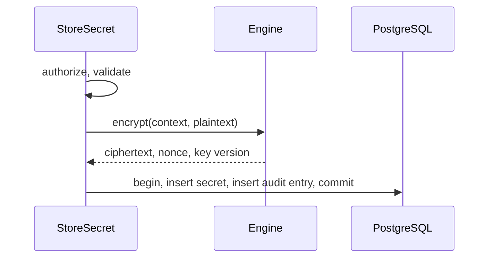
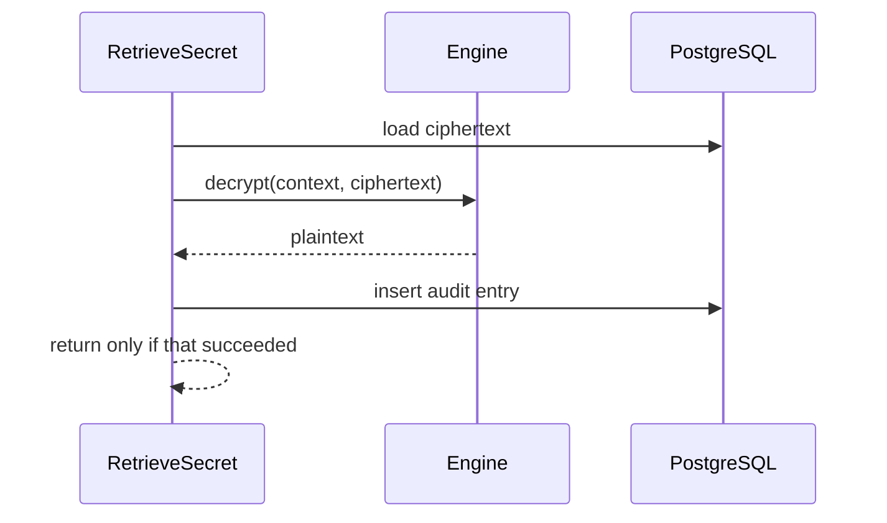

# Architecture

Design rationale and alternatives: [architecture proposal](superpowers/specs/2026-11-24-minivault-design.md).

## Services and communication

| Service | Responsibility | Networks |
|---|---|---|
| web (nginx) | Serves the SPA, proxies `/api` | edge, app |
| api (NestJS) | Identity, authorization, persistence, audit. Holds no master key | app, data, crypto |
| secrets-engine (Go) | Holds master keys, performs AES-256-GCM. Stateless | crypto |
| postgres | Persistence | data |
| migrate, seed | One-shot containers | data (seed also crypto) |

`app`, `data` and `crypto` are internal. The API calls the engine over HTTP with JSON, a bearer service token and the request's correlation id, with a 3 second timeout, no retries and no redirects. Any unexpected answer becomes 503 `ENCRYPTION_UNAVAILABLE`.

## Bounded contexts and aggregates

| Context | Aggregate | Consistency boundary |
|---|---|---|
| identity-access | `User` | Email unique and normalized; holds only an Argon2id hash |
| project-management | `Project` | Name unique per owner; the owner never changes |
| environment-management | `Environment` | One of three names, unique per project |
| secrets-management | `Secret` | Ciphertext, nonce and key version change together; the key never changes |
| api-key-management | `ApiKey`, owning its environment grants | At least one grant when issued; revocation is final |
| audit-management | `AuditEntry` | Immutable; metadata from an allow-list |
| cryptographic-operations (Go) | none, only value objects and `EncryptionContext` | Key, nonce and ciphertext lengths |

Secrets are not part of an environment aggregate: unrelated writes would block each other. Key management in Go is a port and an adapter rather than a context, because keys have no lifecycle inside the product.

## Layers

| Layer | Contains | May import |
|---|---|---|
| domain | Entities, value objects, repository interfaces, domain errors | itself, `shared/domain` |
| application | Use cases, input and output ports, DTOs, transaction boundaries | domain, `shared/application` |
| infrastructure | Controllers, subscribers, Prisma, HTTP client, configuration | application, domain |

Use cases are plain classes without decorators; each Nest module binds them to their input port with a factory. In Go, `cmd/server/main.go` composes everything through constructors.

### Ports and adapters

| Context | Input adapters | Output ports and their adapters |
|---|---|---|
| identity-access | `AuthController`, `AuthGuard` | `UserRepository` (Prisma), `PasswordHasher` (Argon2), `AccessTokenService` (JWT) |
| project-management | `ProjectsController` | `ProjectRepository`, `ProjectStatisticsQuery` (Prisma) |
| environment-management | `EnvironmentsController`, `ProjectCreatedSubscriber` | `EnvironmentRepository` (Prisma), `ProjectAccess` (project context) |
| secrets-management | `SecretsController`, `MachineSecretsController` | `SecretRepository` (Prisma), `EncryptionPort` (Go client), `ProjectAccess`, `EnvironmentDirectory` |
| api-key-management | `ApiKeysController`, `AuthGuard` | `ApiKeyRepository` (Prisma), `ApiKeyGenerator` (node:crypto), `ProjectAccess`, `ProjectEnvironments` |
| audit-management | `AuditLogsController`, `AuditSubscriber` | `AuditRepository` (Prisma), `OwnedProjects` |
| cryptographic-operations | Gin handlers | `Cipher` (AES-GCM), `KeyProvider` (configuration), `NonceGenerator` (crypto/rand) |

Shared ports: `UnitOfWork`, `DomainEventPublisher`, `Clock`, `IdGenerator`, `UserAuthenticator`, `ApiKeyAuthenticator`. The seed script is one more input adapter.

## Dependency direction

`infrastructure -> application -> domain`. One context reaches another only from infrastructure, through the other's input ports. Module dependencies are acyclic.

Enforced by `apps/api/.dependency-cruiser.cjs` and `services/secrets-engine/internal/architecture_test.go`. Both have tests that show each rule rejecting code that breaks it.

## Domain events

Published on an in-process bus inside the caller's transaction, so a subscriber that fails rolls the change back. `ProjectCreated` provisions the three environments; every sensitive event becomes an audit entry. Event classes live in `shared/domain/events`. There is no broker: nothing needs to happen later or elsewhere.

## Database

`users`, `projects`, `environments`, `secrets`, `api_keys`, `api_key_grants`, `audit_logs`; UUID keys, `timestamptz`. Deleting a project cascades to its environments, secrets and keys. `audit_logs` has no foreign keys and rejects UPDATE and DELETE. Uniqueness is decided by constraints, never by a prior read. The transaction travels in `AsyncLocalStorage`, so repositories join it without knowing.

`ProjectStatisticsQuery` is a read model that counts across tables for display. It avoids a module cycle and an artificial dashboard context.

## Authentication and authorization

Guards authenticate; use cases authorize. A resource that is not yours is reported as missing.

## Encryption and decryption

The engine is never called inside a transaction: a slow engine must not hold database connections.

## Decisions

| Decision | Why | Cost |
|---|---|---|
| Secret id in the associated data | Ciphertexts cannot be swapped within an environment | Secrets cannot be renamed |
| Cookie for browsers, bearer for clients | Scripts cannot read the session | An origin check is needed |
| API keys hashed with SHA-256 | Nothing to guess in 256 random bits | |
| Own auth ports rather than `@nestjs/authentication` | Argon2id behind ports, as required | More code |
| No Redis | One instance | In-memory rate limits |
| Jest with ES modules | Required, though Nest 12 scaffolds Vitest | Needs `--experimental-vm-modules` |

## Acceptance evidence

| Criterion | Evidence |
|---|---|
| Domain and application free of frameworks, database and infrastructure | `architecture.spec.ts`, `architecture_test.go` |
| Controllers never reach repositories; Prisma stays in persistence | Rules `controllers-no-persistence`, `prisma-only-in-persistence` |
| Handlers hold no cryptography; use cases do not import Gin | `architecture_test.go` |
| Use cases instantiate no infrastructure | Follows from `application-no-infrastructure` |
| Register and log in | `auth.e2e-spec.ts`, `auth.test.tsx` |
| Manage projects; isolated environments | `projects.e2e-spec.ts`, `environments.e2e-spec.ts` |
| Secrets encrypted, stored and retrieved | `secrets.e2e-spec.ts`, `go-crypto.e2e-spec.ts`, Go tests |
| API keys created, validated, revoked | `api-keys.e2e-spec.ts`, `machine-access.e2e-spec.ts` |
| Sensitive operations audited | `audit.e2e-spec.ts` |
| No user reaches another's data | `isolation.e2e-spec.ts` |
| Dashboard supports the core workflows | `apps/web/src/features/**/*.test.tsx` |
| Compose starts the application | `scripts/verify.sh` (smoke and flow) |
